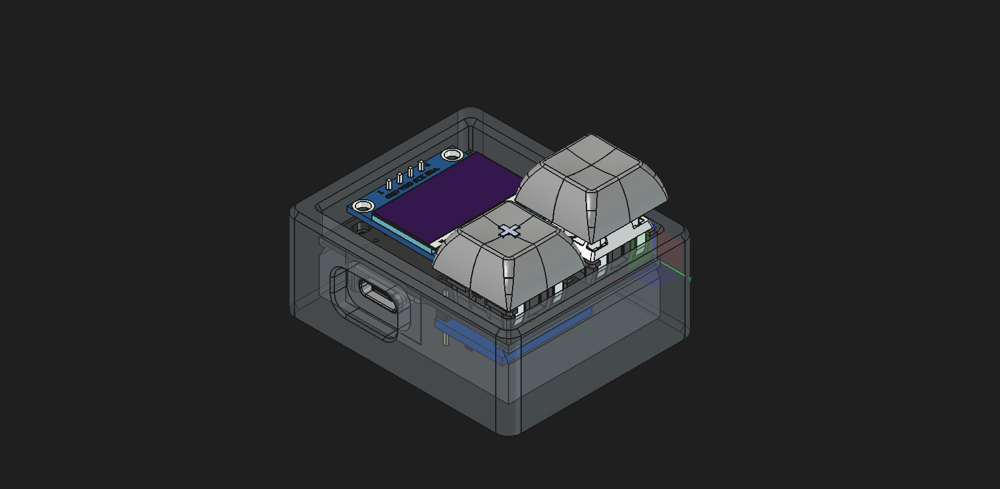
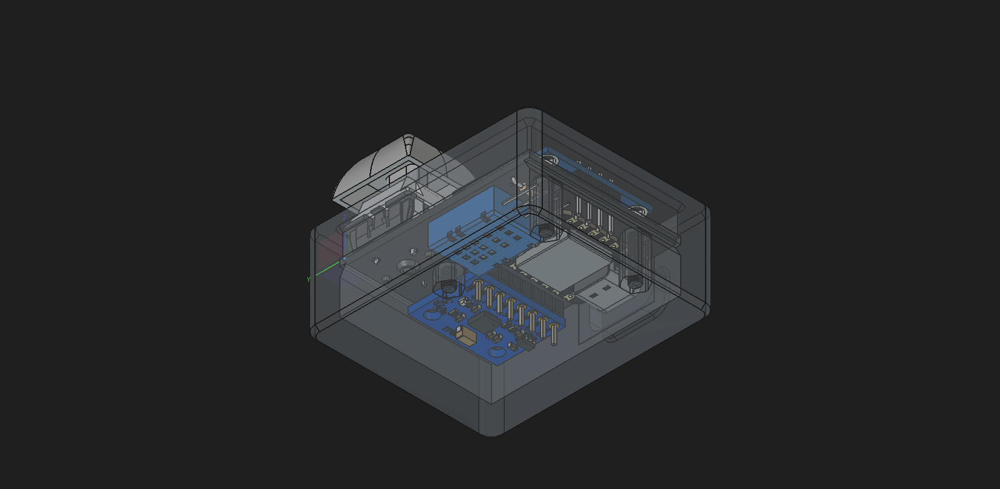

# Starbie Case
|||
|---|---|

This is a case for [Starbie](https://github.com/meeplabsdev/halflife), which I designed in week 1 of [halflife](https://halflife.hackclub.com/).

# What it is
For the second week of halflife I did not follow a tutorial! I learnt how to use, and designed the case with [FreeCad](https://www.freecad.org/). I chose to chamfer or fillet most edges that can be reached from the outside to keep it comfortable to hold. I designed around the PCB (which I imported as a 3D model for reference using the [KiCadStepUp Workbench](https://wiki.freecad.org/KicadStepUp_Workbench) plugin) and kept the tolerances of my manufacturer in mind to make sure everything will fit together nicely.

# Cost
This is a rough outline of the cost, see [`BOM.csv`](BOM.csv) for more details.

| Part | Cost |
| --- | --- |
| [Printed Case](https://jlc3dp.com/) | $8.81 |
| [M2.5 Bolts](https://amzn.eu/d/05BtdnsA) | $8.77 |
| **Total + Shipping** | **$28.63** |
